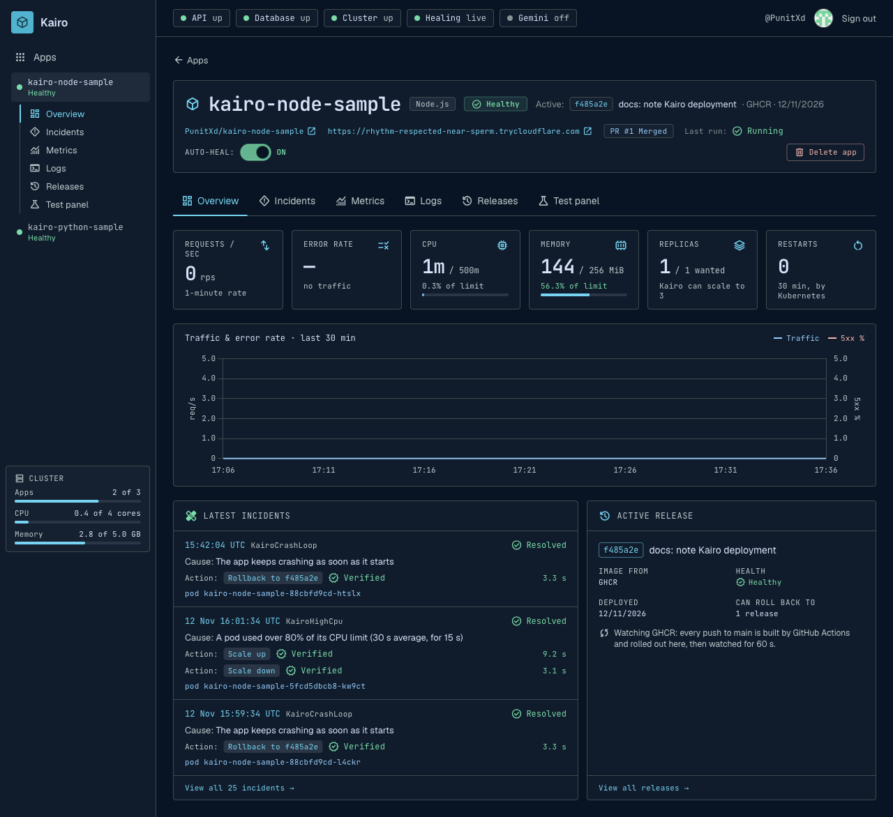
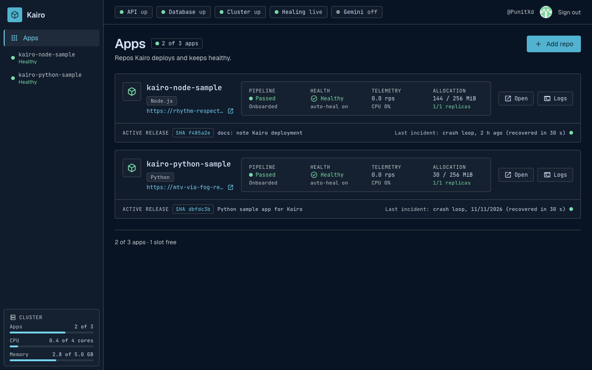
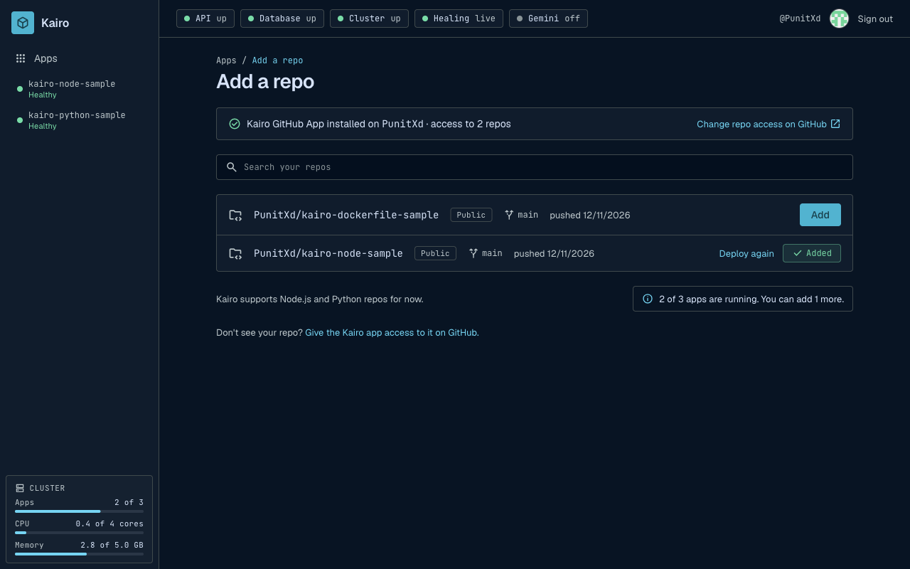
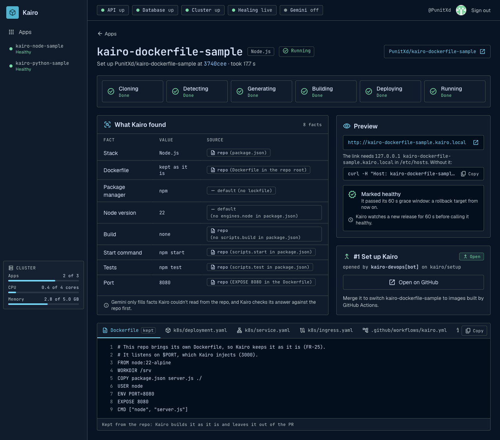
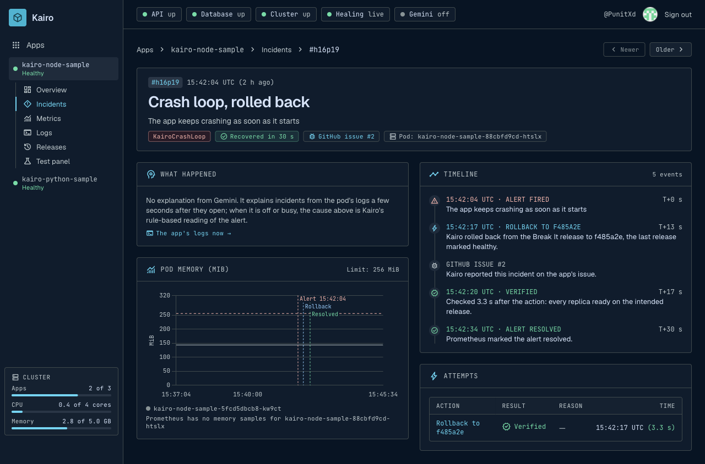
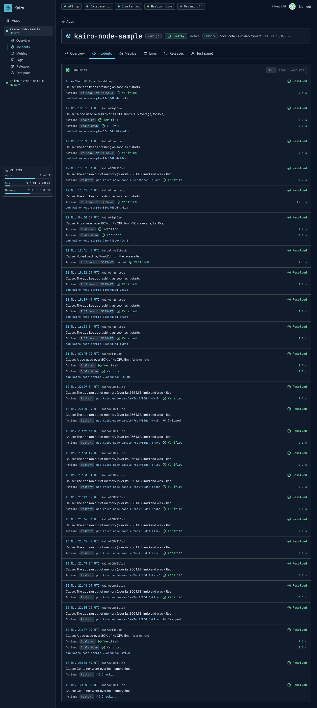
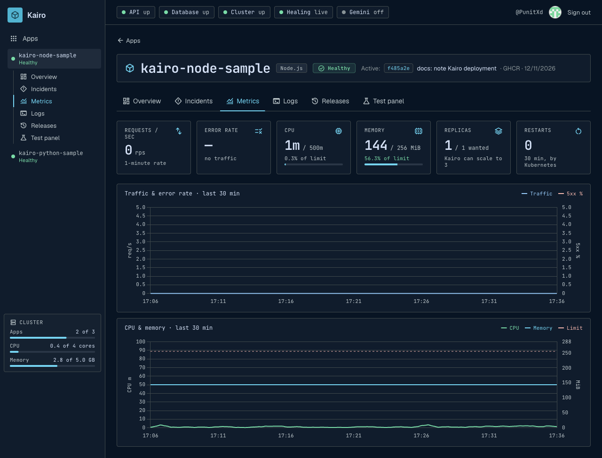
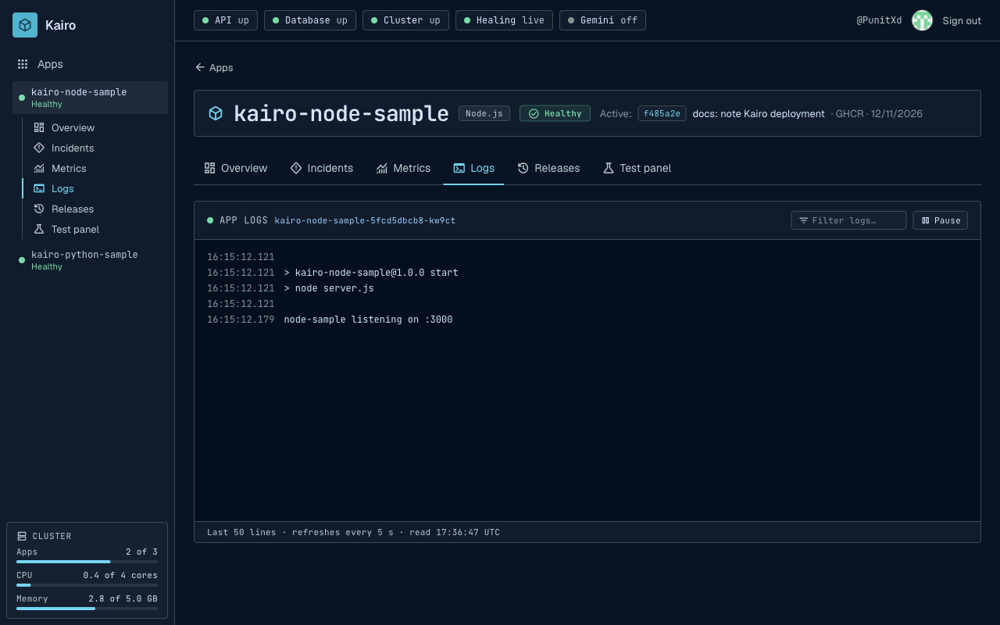
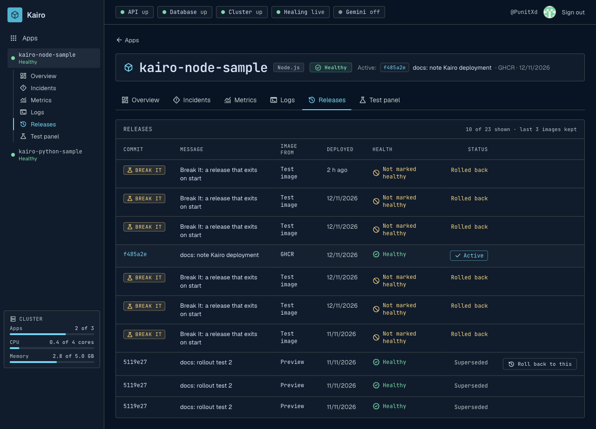
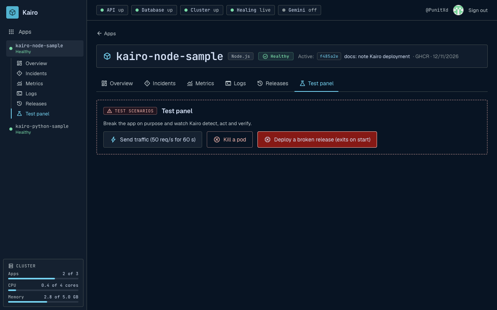

# Kairo

Kairo is a zero-touch DevOps platform for small Node.js and Python apps. You sign in with GitHub and pick a repo. Kairo then does the rest:

- It works out the stack.
- It writes the Dockerfile, Kubernetes manifests, a GitHub Actions workflow and Prometheus alert rules.
- It deploys a preview with a public link and opens a pull request with those files.
- Once the pull request is merged, it rolls out every new image the workflow pushes to GHCR.
- When the app breaks, Kairo heals it on its own (restart, rollback or scale), checks that the fix worked, and reports it on GitHub.

It is a college project. It runs on one laptop with Docker Desktop's Kubernetes, for a small team, and deploys stateless apps from public repos.



## What it does

1. **Onboarding.** You pick a repo from the Kairo GitHub App's installation. Kairo clones it and detects the stack, package manager, start command and port. It reads these from the repo, and says where each fact came from. Gemini fills in only what the repo doesn't say, and Kairo checks Gemini's answer against the repo first. Kairo then generates the files, builds the image, deploys it, and opens a Cloudflare quick tunnel so the preview has a public link.
2. **The pull request.** The Kairo GitHub App's bot opens a PR with the generated files. Its workflow builds and scans the image (Trivy) and pushes it to GHCR. After the merge, Kairo watches GHCR and rolls out each new image of the default branch.
3. **Watching.** Prometheus scrapes every app, and Alertmanager sends Kairo five alerts.
4. **Healing.** Each alert has one fixed action:

   | Alert | When | Kairo's action |
   | --- | --- | --- |
   | `KairoAppDown` | The health check fails for a minute | Restart the pod |
   | `KairoOOMKilled` | The pod ran out of memory (256 MiB limit) | Restart the pod |
   | `KairoCrashLoop` | The new release keeps crashing on start | Roll back to the last healthy release |
   | `KairoHighCpu` | Over 80% of the CPU limit | Scale up (at most 3 replicas), and back down when it is quiet |
   | `KairoHighLatency` | p95 response time over a second for two minutes | Scale up |

   Some rules keep healing safe:
   - A new release gets a 60 s grace window before it counts as healthy.
   - Kairo only rolls back to releases that were marked healthy.
   - Every action is checked through the Kubernetes API within 90 s. If the check fails, the app is marked **Needs attention** and Kairo stops acting on its own.
   - A rollback, or Kairo stopping, opens a GitHub issue on the app's repo, and later incidents comment on it. Each comment links to the incident's page on Kairo.
5. **The dashboard.** Each app has six screens: Overview, Incidents, Metrics, Logs, Releases and a Test panel. Each incident also has its own page. From the Releases screen you can roll back by hand. The Test panel can send traffic, kill a pod, or deploy a release that exits on start, so you can watch Kairo heal it.

## Screenshots

| | |
| --- | --- |
|  **Apps:** every app with its pipeline, health, live numbers and last incident |  **Add a repo:** the repos the Kairo GitHub App can see |
|  **Onboarding:** the steps, what Kairo found and where, the preview, the PR and the generated files |  **Overview:** live numbers, traffic, the latest incidents and the active release |
|  **An incident:** what happened, the pod's memory, the timeline and every action with its check |  **Incidents:** every incident, with its cause and actions |
|  **Metrics:** requests, errors, CPU and memory over 30 minutes, with Kairo's actions marked |  **Logs:** the newest pod's last 50 lines |
|  **Releases:** history and "Roll back to this" |  **Test panel:** break the app on purpose |

## How it is built

| Part | Built with |
| --- | --- |
| Backend (`backend/`) | Node 22, plain JavaScript (ES modules), Express 5, Prisma 6 with PostgreSQL, simple-git, Nunjucks templates, `@kubernetes/client-node`, Octokit (GitHub App), Gemini API |
| Frontend (`frontend/`) | React, Vite, Tailwind, Chart.js |
| Cluster (`infra/`) | Docker Desktop Kubernetes (kubeadm, one node), Traefik, Prometheus and Alertmanager, all installed with Terraform. Kairo's own service account, `kairo-platform`, may only write in `kairo-<app>` namespaces |
| Shipping | GitHub Actions with Trivy, images in GHCR, Cloudflare quick tunnels for public links |

The browser never talks to Prometheus or the cluster: the backend runs fixed queries and fixed actions. Kairo's own dashboard and API are never public; only the apps get public links.

## Running it

You need a Mac with Docker Desktop (Kubernetes switched on, kubeadm provisioner), Node 22, Terraform, `kubectl` and `cloudflared`. You also need a GitHub App of your own for sign-in, repo access and the PRs.

1. **Cluster and platform:** follow [`infra/README.md`](infra/README.md). It covers Docker Desktop's settings, the `kairo-db` Postgres container, `terraform apply`, and the `kairo-platform` kubeconfig.
2. **Backend:** follow [`backend/README.md`](backend/README.md). Copy `.env.example` to `.env` and fill it in, then:

   ```bash
   cd backend
   npm install
   npx prisma migrate deploy
   npm run dev
   ```

3. **Frontend:**

   ```bash
   cd frontend
   npm install
   npm run dev
   ```

4. Open http://localhost:5173 and sign in with GitHub. Your login must be in `ALLOWED_GITHUB_LOGINS`.

`GEMINI_ENABLED=false` turns Gemini off; everything still works with Kairo's rules. `REMEDIATION_DRY_RUN=true` records what Kairo would do without touching any pod.

Tests: `npm test` in `backend/`.

## Repo layout

| Folder | What it holds |
| --- | --- |
| `backend/` | The API, the generator (repo → files, with its Nunjucks templates in `backend/templates/`), shipping (build, deploy, GHCR, tunnels) and remediation (alerts → actions → checks → issues) |
| `frontend/` | The dashboard |
| `infra/` | Terraform, Helm values, RBAC and the admission policy, setup scripts |
| `sample-apps/` | The Node.js and Python sample apps used in the demo |
| `docs/api/` | Every API endpoint and its responses |
| `docs/demo/` | The demo run sheet |

## npm audit

The patch updates that fix advisories are applied. These findings remain, and none can be reached in the way Kairo runs:

| Package | Advisory | Why it stays |
| --- | --- | --- |
| `prisma` → `@prisma/config` → `deepmerge-ts` (backend, 3 entries) | Stack exhaustion when merging recursive object graphs | The fix needs Prisma 7, a major upgrade. Only the Prisma command-line tool loads `deepmerge-ts`, to read its own config; the client the API runs doesn't use it |
| `nunjucks` → `chokidar` → `anymatch`, `readdirp` → `picomatch` (backend, 5 entries) | ReDoS with some glob patterns | `nunjucks` loads `chokidar` only to watch templates for changes, which Kairo never turns on. No `picomatch` release fixes it yet (4.0.7 is the newest) |
| `vite`, `@vitejs/plugin-react`, `tinyglobby`, `fdir` → `picomatch` (frontend, 5 entries) | The same ReDoS | Build and dev-server tools: none of it is in the built dashboard, and the patterns come from Vite's own config. No fixed `picomatch` release yet |

npm's suggested `--force` fixes would downgrade `vite` to 6 and `nunjucks` to 3.2.0, so they are not applied.
